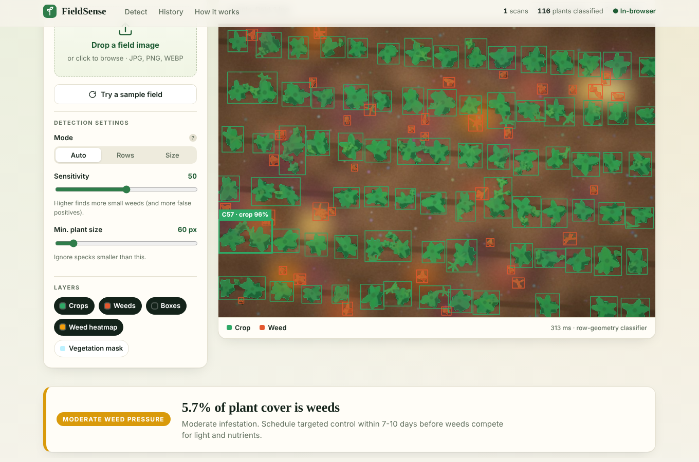

# 🌱 FieldSense — Crop & Weed Detection

Upload a top-down field photo and FieldSense separates **crops from weeds**, maps where weeds are
concentrated, rates the weed pressure and estimates how much herbicide **spot-spraying** could save.

**Live demo:** `https://<your-username>.github.io/<repo-name>/` *(after you follow "Publish on GitHub" below)*



## Two ways to run it (same UI, same results)

| Mode | What runs the detection | Needs a server? | History stored in |
|---|---|---|---|
| **In-browser** (GitHub Pages) | `frontend/detector.js` (JavaScript) | No — static files only | Your browser (IndexedDB) |
| **Full-stack** (Flask) | `backend/detector.py` (Python + OpenCV) | Yes | SQLite |

The page checks for the Flask API on load and falls back to in-browser mode automatically, so the
exact same `frontend/` folder works on both. The badge in the top-right shows which mode is active.
The two detectors are ports of each other and agree closely (same crop-row angles, crop/weed counts
within a few plants on the bundled samples).

## Publish on GitHub (free, takes 2 minutes)

```bash
cd fieldsense                      # the unzipped project folder
git init
git add .
git commit -m "FieldSense: crop & weed detection"
git branch -M main
git remote add origin https://github.com/<your-username>/<repo-name>.git
git push -u origin main
```

Then on GitHub: **Settings → Pages → Build and deployment → Source: _GitHub Actions_**.
The included workflow (`.github/workflows/pages.yml`) deploys the `frontend/` folder on every push to
`main`. After about a minute your site is live at `https://<your-username>.github.io/<repo-name>/`.

> Opening `index.html` by double-clicking works for the UI, but the sample images need a web server
> (browser security rule). Use GitHub Pages, or run `python -m http.server` inside `frontend/`.

## Run locally

**Static / in-browser:**
```bash
cd frontend && python -m http.server 8000      # → http://localhost:8000
```

**Full-stack with Flask:**
```bash
cd backend
pip install -r requirements.txt
python app.py                                  # → http://127.0.0.1:5000
```

## Project layout

```
frontend/                 ← this folder alone is the deployable website
  index.html style.css app.js
  detector.js             in-browser detection engine (JS port)
  engines.js              picks Flask API or in-browser engine, IndexedDB history
  samples/                4 demo field images
backend/
  app.py                  Flask API + serves the frontend, SQLite persistence
  detector.py             detection engine (Python + OpenCV)
  sample_field.py         synthetic field generator used to make the samples
.github/workflows/pages.yml   GitHub Pages deployment
```

## How the detection works

1. **Vegetation segmentation** — Excess-Green index `ExG = 2g − r − b`, adaptive Otsu threshold,
   HSV guard against soil/shadow, morphological clean-up.
2. **Blob analysis** — connected components → area, bounding box, centroid, solidity.
3. **Crop-row estimation** — plant pixels are projected onto a rotating axis (−90°…90°); the angle
   with the sharpest profile is the row direction and the autocorrelation gives row spacing and a
   confidence score.
4. **Classification** — plants on a row line at the typical crop size → **crop**; off-row or
   undersized plants → **weed**. Without a clear row pattern it falls back to size/shape rules.
5. **Analytics** — coverage %, weed pressure (Low/Moderate/High/Severe), weed-density grid, heat
   map, spot-spray plan and estimated herbicide saving versus blanket spraying.

## Flask API (full-stack mode)

| Method | Endpoint | Purpose |
|---|---|---|
| POST | `/api/analyze` | multipart `image`, optional `sensitivity` (0-100), `min_area`, `mode` (`auto`/`rows`/`size`) |
| GET | `/api/analyses` · `/api/analyses/<id>` | scan history / one scan |
| DELETE | `/api/analyses/<id>` | delete a scan |
| GET | `/api/analyses/<id>/export.csv` · `export.json` | detections export |
| GET | `/api/stats` · `/api/health` · `/api/sample?seed=7` | totals, health check, demo image |

## Limitations (say these up front in a demo)

- This is a **classical computer-vision baseline**, not a trained neural network. It works best on
  top-down images of **row crops** on bare soil and uses crop-row geometry plus size to decide what
  is a weed. It cannot tell weed species apart.
- Weeds touching a crop are merged with it into one blob.
- If an image has weeds but no crops, the size fallback will still label the largest plants as crops.
- Results are indicative; confirm with field scouting before applying any treatment.

## Upgrade path: deep learning

Train an Ultralytics YOLO model on a labelled dataset (e.g. CropAndWeed, DeepWeeds or a Roboflow
weed dataset) with classes `crop` and `weed`, save it as `backend/models/best.pt` and
`pip install ultralytics`. `backend/detector.py` already contains a `YoloDetector` hook that returns
the same detection schema, so the UI needs no changes. For GitHub Pages you could export the model to
ONNX and run it with `onnxruntime-web`.

## Ideas to extend

Per-species classification · drone orthomosaic tiling · GPS-tagged spray maps (GeoJSON export) ·
side-by-side comparison of two dates to track weed growth.
